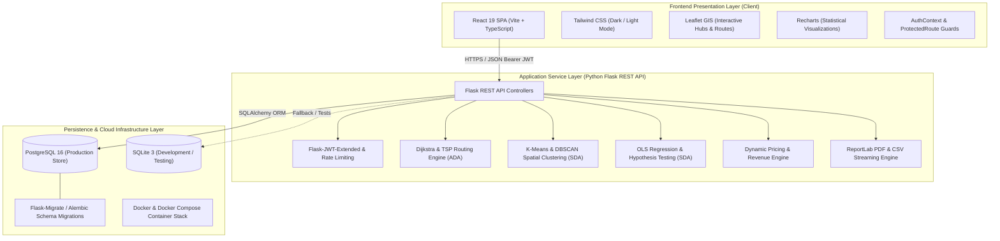
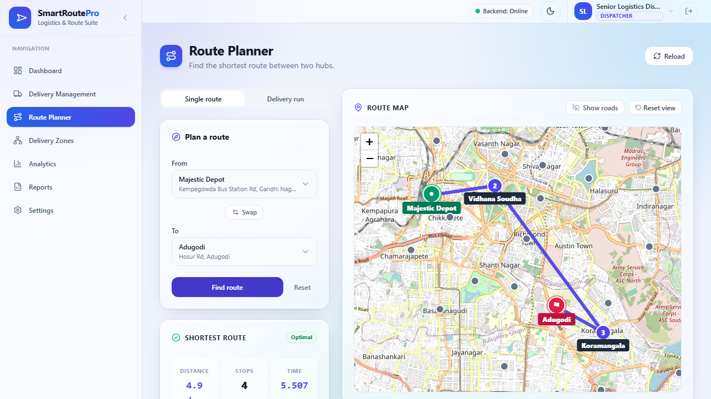
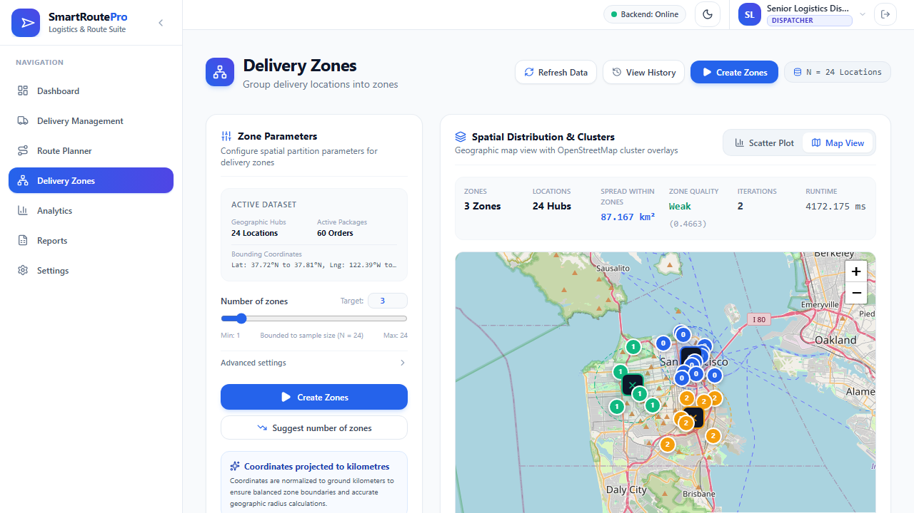
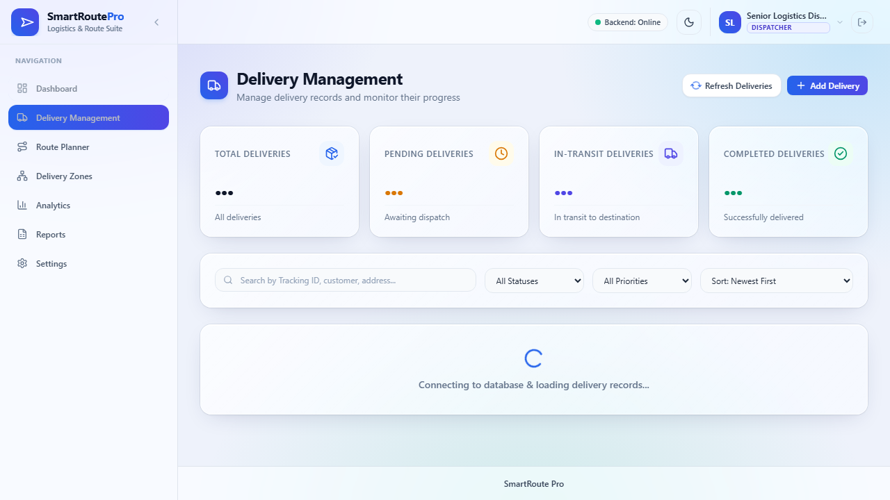
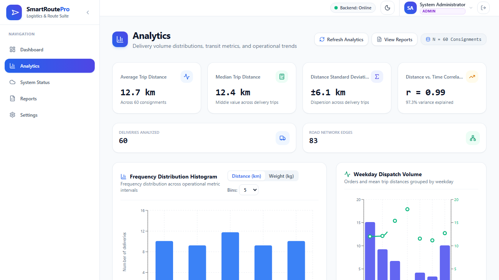
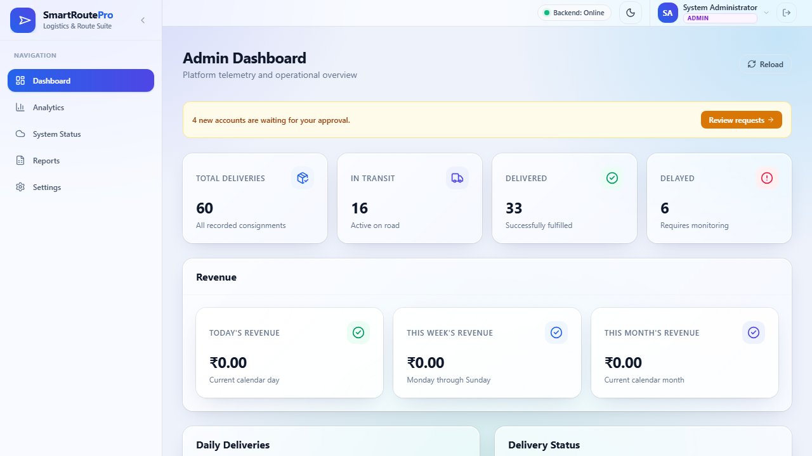
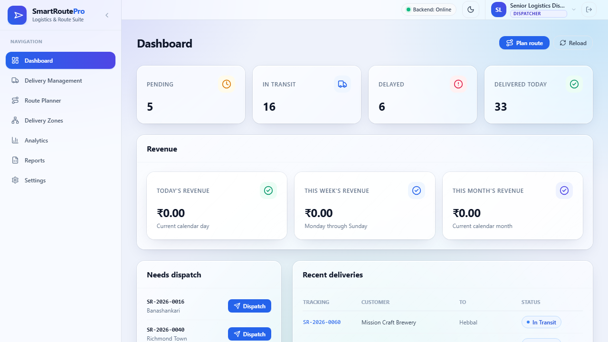
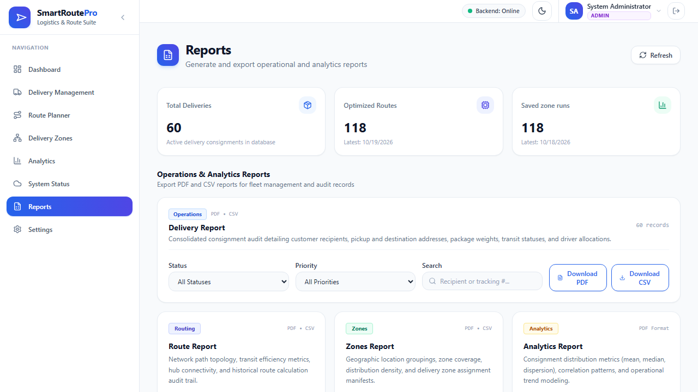

# SmartRoute Pro: Intelligent Logistics Optimization & Analytics Platform

<div align="center">


[](https://www.python.org/)
[](https://flask.palletsprojects.com/)
[](https://react.dev/)
[](https://www.typescriptlang.org/)
[](https://tailwindcss.com/)
[](https://www.postgresql.org/)
[](https://www.docker.com/)
[](backend/tests/)
[](frontend/e2e/)

**Enterprise-grade logistics route optimization, spatial territory clustering, consignment lifecycle management, and real-time operational analytics.**

[Key Components](#-key-components--system-features) • [Architecture](#-system-architecture) • [Project Structure](#-project-structure) • [Prerequisites](#-prerequisites--system-requirements) • [Quick Start](#-quick-start-guide) • [Security & RBAC](#-security--role-based-access-control-rbac) • [Documentation](#-documentation-index)

</div>

---

## 📋 Executive Overview

**SmartRoute Pro** is a modern full-stack web application designed for transport coordinators, fleet dispatchers, logistics analysts, and operations executives. It tackles real-world logistics challenges by unifying **advanced graph-theoretic routing algorithms**, **machine-learning geospatial clustering**, **dynamic rate-based parcel pricing**, and **inferential statistical telemetry** into a unified, responsive dashboard.

### Core Value Propositions
* **Algorithmic Route Optimization**: Computes single-source shortest paths via Dijkstra's Algorithm and multi-stop vehicle itineraries via Traveling Salesperson Problem (TSP) solvers with live arrival time projections.
* **Geospatial Territory Partitioning**: Uses unsupervised machine learning ($K$-Means and DBSCAN) with equirectangular spherical projections to cluster regional delivery hubs into balanced delivery zones.
* **Real-time Financial & Consignment Telemetry**: Real-time package tracking across priority tiers (`Standard`, `Express`, `Urgent`), localized financial accounting (`Asia/Kolkata` timezone), and live database engine health monitoring.
* **Statistical Rigor & Decision Support**: Built-in Ordinary Least Squares (OLS) regression models, hypothesis testing (Student's $t$-test, One-way ANOVA, $\chi^2$ independence), and automated PDF/CSV report generation.

---

## 🏛️ System Architecture

SmartRoute Pro implements an enterprise **Three-Tier Architecture** ensuring high cohesion, loose coupling, deterministic reproducibility, and strict boundary separation.

<div align="center">


</div>

### Architectural Tiers Breakdown



1. **Presentation Layer (Frontend)**:
   * Built on **React 19**, **TypeScript 6**, and **Vite 8** for high-performance rendering.
   * Styled with modern, accessible **Tailwind CSS 3.4** supporting native system dark mode and theme switching.
   * Interactive geospatial visualization powered by **Leaflet 1.9** with customized waypoint markers and animated polyline trajectories.
   * Analytical charts, distributions, and financial trends rendered through **Recharts 3.10**.

2. **Application Layer (Backend REST API)**:
   * Powered by **Python 3.11** and **Flask 3.0+** running under **Gunicorn WSGI**.
   * Stateless authentication utilizing **JSON Web Tokens (JWT)** with token blocklist revocation and **Flask-Limiter** rate-limiting.
   * **Pure Computational Services**: All algorithmic engines (graph search, TSP solver, spatial clustering, linear regression, and financial calculators) are implemented as pure, framework-agnostic Python functions for optimal unit testability and mathematical purity.

3. **Persistence & Infrastructure Layer**:
   * **PostgreSQL 16** serving as the primary relational data store with ACID transactional guarantees.
   * Seamless local fallback to **SQLite 3** for zero-configuration developer onboarding and lightning-fast in-memory test suites.
   * Schema migrations tracked and versioned through **Alembic / Flask-Migrate**.
   * Container orchestration managed via multi-stage **Dockerfiles** and `docker-compose.yml`.

---

## 🚀 Key Components & System Features

### 1. Graph-Theoretic Route Optimization & Delivery Runs (ADA)
The routing engine provides mathematical route resolution across connected hub networks:
* **Single Route Solver (Dijkstra)**: Implements Dijkstra's algorithm with min-heap priority queues ($O((V + E) \log V)$) to evaluate optimal transit paths, total distance, and duration between hubs.
* **Multi-Stop Delivery Run Solver (TSP)**:
  * Solves multi-stop driver itineraries. Evaluates up to 8 delivery stops via exact branch-and-bound / permutation search and scales to larger batches via 2-opt nearest-neighbor heuristics.
  * Calculates cumulative driving durations, standard 5-minute service times per stop, and deterministic arrival time offsets (`arrival_offsets_min`).
  * Features direct driver consignment dispatching (`POST /api/routes/delivery-run/dispatch`).

<div align="center">


*Interactive GPS Map, Dijkstra Shortest Path, and Multi-Stop Delivery Run Itinerary*

</div>

<div align="center">



</div>

---

### 2. Spatial Territory Clustering & Hub Analytics (SDA)
Logistics networks require optimal partitioning of geographical waypoints into manageable delivery zones:
* **$K$-Means & DBSCAN Clustering**: Transforms geodesic coordinates (latitude/longitude) into Euclidean space via equirectangular projections and groups hubs into operational zones.
* **Algorithmic Validation**: Generates silhouette scores, inertia evaluations, and interactive elbow curve plots to recommend mathematically optimal cluster counts ($k$).
* **ZonePicker Workflow**: Dispatchers can filter pending consignments by geographical zone and automatically stage deliveries for vehicle dispatch.

<div align="center">



*Geospatial Hub Clustering with Zone Partitions, Inertia Metrics, and Centroid Telemetry*

</div>

---

### 3. Consignment Lifecycle & Real-Time Revenue Engine
End-to-end package tracking, dynamic weight-based pricing, and financial metrics:
* **Consignment State Machine**: Strict status transitions (`Pending` $\rightarrow$ `In Transit` $\rightarrow$ `Delivered` / `Delayed` / `Cancelled`).
* **Dynamic Pricing Engine**:
  * Standard Tier: ₹50.00 / kg
  * Express Tier: ₹75.00 / kg
  * Urgent Tier: ₹100.00 / kg
* **Revenue Accounting**:
  * Revenue is strictly recognized upon package delivery (`Delivered`), timestamped in local application timezone (`APP_TIMEZONE Asia/Kolkata`).
  * Real-time monitoring of **Earned Revenue** (Today, This Week, This Month, All Time) alongside **Awaiting Delivery** pipeline value.
  * Idempotent CLI command `flask backfill-prices` for zero-downtime retroactive pricing.

<div align="center">



*Consignment Management Table with Dynamic Price Column, Priority Filters, and Search*

</div>

---

### 4. Statistical Data Analytics & Hypothesis Testing
A comprehensive analytical suite giving operations managers empirical insights into fleet performance:
* **Univariate Statistics**: Mean, median, standard deviation, interquartile range (IQR), skewness, and parametric confidence intervals.
* **Bivariate OLS Regression**: Models distance vs. transit duration with Pearson correlation ($r$), coefficient of determination ($R^2$), slope, intercept, and $p$-value metrics.
* **Inferential Hypothesis Testing**:
  * Two-sample Student's $t$-test (evaluating speed differences across priority classes).
  * One-way ANOVA (evaluating weight variations across delivery hubs).
  * Chi-Square ($\chi^2$) Test of Independence (evaluating delivery status vs. priority).
* **30-Day Revenue Trends**: Interactive daily revenue bar charts and priority breakdowns.

<div align="center">



*Statistical Telemetry: Volume Distributions, Regression Scatter Plots, and Hypothesis Tests*

</div>

---

### 5. Role-Specific Dashboards & System Telemetry
Custom operational views tailored to specific organizational roles:
* **Administrator Dashboard**: Live system health telemetry, database engine status (PostgreSQL/SQLite dialect, connection state, version), sub-millisecond API latency monitoring, and user approval workflows.
* **Dispatcher Dashboard**: Real-time consignment staging, pending package queues, delivered today counters, and one-click dispatch triggers.
* **Viewer Dashboard**: Consumer-facing parcel tracking by tracking number or email with delivery status details.

| Administrator Dashboard | Dispatcher Dashboard |
| :---: | :---: |
|  |  |

---

### 6. Automated PDF & CSV Export Catalog
Enterprise reporting service powered by ReportLab:
* High-resolution, multi-page vector PDF reports with corporate headers, tabular parcel logs, and statistical breakdown matrices.
* Sanitized RFC-4180 CSV exports mitigating CSV formula injection vulnerabilities.

<div align="center">



</div>

---

## 📂 Project Structure

The repository is organized cleanly into modular frontend, backend, test, and documentation directories:

```
SmartRoute-Pro/
├── .github/                      # CI/CD Workflows (GitHub Actions automated test pipelines)
├── backend/                      # Python Flask REST API & Computational Services
│   ├── app/
│   │   ├── api/                  # RESTful API Endpoints & Route Controllers
│   │   │   ├── auth.py           # User authentication, JWT issuance, profile updates
│   │   │   ├── cloud.py          # Cloud telemetry, live DB inspection, latency metrics
│   │   │   ├── dashboard.py      # Summary KPIs, localized revenue periods & breakdowns
│   │   │   ├── deliveries.py     # Consignment CRUD, status transitions, auto-pricing
│   │   │   ├── reports.py        # PDF/CSV streaming and downloadable dossier exports
│   │   │   ├── routes.py         # Dijkstra shortest path & TSP dispatch endpoints
│   │   │   └── sda.py            # Spatial clustering runs, regression & hypothesis tests
│   │   ├── models/               # SQLAlchemy ORM Database Schemas
│   │   │   ├── cluster.py        # ClusterRun & ClusterAssignment models
│   │   │   ├── delivery.py       # Delivery consignment model with price & timestamps
│   │   │   ├── location.py       # Location (Hub) model with GPS coordinates
│   │   │   ├── road.py           # Road network segments with distance & durations
│   │   │   ├── route.py          # RouteRun computation cache model
│   │   │   └── user.py           # User model & TokenBlocklist model
│   │   ├── services/             # Pure Algorithmic & Business Logic Services
│   │   │   ├── clustering.py     # K-Means, DBSCAN, silhouette, elbow calculations
│   │   │   ├── delivery_run.py   # Multi-stop TSP solver & arrival offset calculations
│   │   │   ├── dijkstra.py       # Shortest path graph solver with min-heap priority queue
│   │   │   ├── pricing.py        # Pure parcel pricing formulas based on weight & priority
│   │   │   ├── reporting.py      # ReportLab PDF & sanitized CSV generation logic
│   │   │   ├── revenue.py        # Pure revenue aggregation by calendar day & priority
│   │   │   └── statistics.py     # Univariate metrics, OLS regression, hypothesis tests
│   │   └── utils/                # Cross-Cutting Utilities & Helpers
│   │       ├── decorators.py     # Permission enforcement & JWT claim validators
│   │       ├── permissions.py    # Canonical permissions & role capability mappings
│   │       └── timezone.py       # Localized application timezone wrapper (Asia/Kolkata)
│   ├── migrations/               # Alembic database schema migration history
│   ├── tests/                    # Pytest Test Suite (212 unit & integration tests)
│   │   ├── test_auth.py          # Authentication & token blocklist tests
│   │   ├── test_deliveries.py    # Delivery CRUD & status machine tests
│   │   ├── test_pricing_revenue.py# Pricing rates, backfill CLI, & revenue breakdown tests
│   │   ├── test_routes.py        # Dijkstra & TSP routing algorithm tests
│   │   └── test_sda.py           # Spatial clustering & statistical tests
│   ├── requirements.txt          # Python production & test dependencies
│   ├── run.py                    # Local Flask development server entry point
│   └── seed.py                   # Deterministic database seeding script
├── frontend/                     # React 19 Single Page Application (SPA)
│   ├── e2e/                      # Playwright End-to-End Test Suite (44 browser tests)
│   │   ├── admin_flow.spec.ts    # Administrator management E2E workflow
│   │   ├── delivery_run.spec.ts  # Multi-stop delivery run & dispatch E2E workflow
│   │   └── revenue_dashboard.spec.ts # Dynamic revenue, pricing & analytics E2E test
│   ├── src/
│   │   ├── app/                  # Application Contexts & Route Protections
│   │   │   ├── AuthContext.tsx   # Global authentication state & user credentials
│   │   │   └── ThemeContext.tsx  # Dark / Light theme toggle provider
│   │   ├── components/           # Reusable UI Component Library
│   │   │   ├── cards/            # StatCard, SectionCard, MetricCard components
│   │   │   ├── Navbar.tsx        # Top navigation with live system health popup
│   │   │   ├── Sidebar.tsx       # Role-aware collapsible navigation sidebar
│   │   │   └── ProtectedRoute.tsx# Role-based route guard wrapper
│   │   ├── layouts/              # Main application shell & page layouts
│   │   ├── pages/                # Primary Application Views
│   │   │   ├── dashboards/       # AdminDashboard, DispatcherDashboard, ViewerDashboard
│   │   │   ├── route/            # RouteOptimization, ZonePicker, DeliveryRunResult
│   │   │   ├── ClusterAnalysis.tsx # Spatial territory clustering & map view
│   │   │   ├── Deliveries.tsx    # Consignment data table with live filters & modal
│   │   │   ├── Reports.tsx       # PDF/CSV export management center
│   │   │   ├── Settings.tsx      # User profile, RBAC matrix, and system preferences
│   │   │   └── StatisticalAnalytics.tsx # Revenue bar charts, regression, hypothesis tests
│   │   ├── services/             # Axios API Client & Typed Service Handlers
│   │   │   └── api.ts            # Centralized API service wrappers
│   │   ├── types/                # Central TypeScript Interface Definitions
│   │   │   └── index.ts          # Strongly-typed data models & API responses
│   │   └── utils/                # Frontend Utility Functions
│   │       ├── formatINR.ts      # Indian Rupee currency formatter (Intl.NumberFormat)
│   │       └── sanitize.ts       # Input sanitization and formatting helpers
│   ├── package.json              # Frontend npm dependencies and scripts
│   ├── tailwind.config.js        # Tailwind CSS theme & plugin configurations
│   └── vite.config.ts            # Vite bundler, proxy & build configurations
├── docs/                         # Comprehensive Engineering Documentation
│   ├── images/                   # High-resolution architectural diagrams & banners
│   ├── screenshots/              # System interface screenshots across all modules
│   ├── ADA.md                    # Analysis & Design of Algorithms (Dijkstra, TSP, Benchmarks)
│   ├── API.md                    # Complete REST API Specification & Endpoint Schema
│   ├── ARCHITECTURE.md           # System Architecture, ERD, and Security Model
│   ├── CC.md                     # Cloud Computing, Containerization, & CI/CD Telemetry
│   ├── DEMO.md                   # 10-Minute Presentation & Role Demonstration Guide
│   └── SDA.md                    # Statistical Data Analysis & Hypothesis Testing Guide
├── docker-compose.yml            # Multi-container orchestration (DB, API, Frontend)
├── .env.example                  # Environment configuration template
└── README.md                     # Project documentation & user guide
```

---

## ⚙️ Prerequisites & System Requirements

Before running SmartRoute Pro, ensure your environment meets the following specifications:

### Hardware Specifications
| Specification | Minimum Requirement | Recommended Specification |
| :--- | :--- | :--- |
| **CPU Architecture** | x86_64 or ARM64 (Apple Silicon / Graviton) | Modern Quad-Core CPU (2.4 GHz+) |
| **RAM** | 4 GB | 8 GB or higher |
| **Disk Space** | 2.5 GB free storage | 5.0 GB SSD storage |
| **Display** | $1280 \times 720$ resolution | $1920 \times 1080$ (Full HD) or higher |

### Software & Environment Dependencies
* **Python**: Version `3.11.x` or higher (Python 3.12 compatible).
* **Node.js**: Version `20.x` LTS or higher.
* **Package Managers**: `pip` (Python) and `npm` `10.x`+ (Node).
* **Container Runtime (Optional)**: Docker Engine `24.0+` with Docker Compose `v2.20+`.
* **Database (Optional for local dev)**: PostgreSQL `16.x` (SQLite 3 is included and used automatically if PostgreSQL is omitted).
* **Operating Systems**: Windows 10/11 (PowerShell), Ubuntu Linux 22.04 LTS+, macOS Sonoma+.

---

## ⚡ Quick Start Guide

You can run SmartRoute Pro using **Docker Compose** (recommended for production-like environments) or **Manual Local Setup** (recommended for active development).

### Method A: Docker Deployment (Fastest)

Run the entire SmartRoute Pro stack (PostgreSQL 16, Flask Gunicorn API, and React/Nginx SPA) with pre-seeded data in a single command:

```bash
# 1. Clone the repository
git clone https://github.com/your-username/SmartRoute-Pro.git
cd SmartRoute-Pro

# 2. Copy the environment variables template
cp .env.example .env

# 3. Build and launch the container stack in detached mode
docker compose up --build -d
```

Once launched:
* **Frontend Web Interface**: Accessible at [http://localhost:8080](http://localhost:8080)
* **Backend REST API**: Accessible at [http://localhost:5000](http://localhost:5000)
* **API Health Check**: Verify live status at [http://localhost:5000/api/health](http://localhost:5000/api/health)

---

### Method B: Manual Local Setup (Developer Mode)

#### 1. Backend Setup (Flask API)
```bash
# Navigate to the backend directory
cd backend

# Create and activate a Python 3.11 virtual environment
python -m venv venv

# Windows (PowerShell):
.\venv\Scripts\Activate.ps1
# Linux / macOS:
source venv/bin/activate

# Install required dependencies
pip install -r requirements.txt

# Populate database with deterministic demonstration data
python seed.py

# Launch the Flask development server
python run.py
```
*Backend server runs at:* `http://127.0.0.1:5000`

#### 2. Frontend Setup (React SPA)
```bash
# In a separate terminal, navigate to the frontend directory
cd frontend

# Install npm dependencies
npm install

# Start the Vite development server
npm run dev
```
*Frontend interface runs at:* `http://localhost:5173`

---

## 🔐 Security & Role-Based Access Control (RBAC)

SmartRoute Pro implements an enterprise **Role-Based Access Control (RBAC)** architecture. System functions are guarded by fine-grained permissions:

### Pre-Configured Demo Credentials

The platform includes seeded accounts for testing and demonstration:

| Role | Email | Password | Capabilities & Scope |
| :--- | :--- | :--- | :--- |
| **Administrator** | `admin@smartroute.pro` | `Admin@123456` | Full system governance, user approvals, live telemetry, global revenue analytics, system-wide PDF audit reports |
| **Dispatcher** | `dispatcher@smartroute.pro` | `Dispatch@123456` | Consignment CRUD, dynamic route optimization, multi-stop TSP runs, spatial clustering, fleet dispatching |
| **Viewer** | `viewer@smartroute.pro` | `Viewer@123456` | Read-only consignment tracking by tracking code or email, personal delivery summary PDF downloads |

*Note: In development mode (`import.meta.env.DEV`), one-click demo login buttons are available on the login screen to streamline evaluation.*

### Granular Permission Matrix

| Canonical Permission | Description | ADMIN | DISPATCHER | VIEWER |
| :--- | :--- | :---: | :---: | :---: |
| `dashboard:read` | Inspect operational KPIs, delivery status counters, fleet stats | ✅ | ✅ | ✅ |
| `dashboard:revenue` | Inspect financial revenue cards, awaiting delivery values, 30-day bar chart | ✅ | ✅ | ❌ |
| `deliveries:read` | Search, filter, and inspect consignment records and waypoints | ✅ | ✅ | ❌ |
| `deliveries:write` | Create, modify, delete, and dispatch consignments | ✅ | ✅ | ❌ |
| `routes:read` | Inspect graph topology, hub nodes, and historical route runs | ✅ | ✅ | ❌ |
| `routes:calculate` | Execute Dijkstra shortest path and multi-stop TSP delivery runs | ✅ | ✅ | ❌ |
| `zones:read` | View spatial cluster assignments, centroids, and elbow plots | ✅ | ✅ | ❌ |
| `zones:calculate` | Execute $K$-Means / DBSCAN clustering on spatial distribution hubs | ✅ | ✅ | ❌ |
| `analytics:read` | View regression trends, hypothesis tests, and distribution curves | ✅ | ✅ | ❌ |
| `reports:export` | Generate and download formal PDF dossiers and CSV logs | ✅ | ✅ | ❌ |
| `admin:users` | Manage user approval statuses and assign access roles | ✅ | ❌ | ❌ |
| `admin:system` | Access low-level database engine info and cloud telemetry | ✅ | ❌ | ❌ |

---

## 🧪 Testing & Quality Assurance

SmartRoute Pro adheres to rigorous automated testing standards across the entire stack.

### Backend Unit & Integration Tests (Pytest)
The backend test suite validates authentication, Dijkstra calculations, TSP heuristics, spatial clustering, pricing calculations, localized revenue aggregations, and PDF/CSV reporting:

```bash
cd backend
pytest
```
*Current test suite status:* **212 passed, 0 failures** (100% pass rate).

### Frontend End-to-End Tests (Playwright)
Playwright browser automation verifies end-to-end user workflows, role permissions, interactive map rendering, dynamic pricing columns, and modal interactions across Chromium, Firefox, and WebKit:

```bash
cd frontend
npx playwright test
```
*Current E2E suite status:* **44 passed across all role suites**.

### Production TypeScript Build
Verify TypeScript typing integrity and production bundler packaging:
```bash
cd frontend
npm run build
```

---

## 🛠️ Configuration & Environment Variables

Copy `.env.example` to `.env` in the root or backend directory to customize runtime parameters:

```ini
# Flask Core Settings
FLASK_ENV=production
FLASK_APP=app:create_app
SECRET_KEY=change-to-a-secure-random-secret-key-in-production
JWT_SECRET_KEY=change-to-a-secure-random-jwt-key-in-production

# Application Localization
APP_TIMEZONE=Asia/Kolkata

# Database Connection (Default: PostgreSQL container; fallback: SQLite)
DATABASE_URL=postgresql://postgres:postgres@db:5432/smartroute_pro
# Local SQLite example: sqlite:///smartroute.db

# Security & CORS
CORS_ORIGINS=http://localhost:5173,http://localhost:8080,http://127.0.0.1:5000
RATELIMIT_DEFAULT=200/minute
RATELIMIT_STORAGE_URI=memory://
```

---

## 📚 Documentation Index

For in-depth architectural and mathematical explanations, consult the dedicated manuals in the `docs/` directory:

* 📐 **[System Architecture & Security (ARCHITECTURE.md)](docs/ARCHITECTURE.md)**: Deep dive into the 3-tier architecture, database schema, entity-relationship diagrams, and RBAC matrix.
* 🌐 **[REST API Reference (API.md)](docs/API.md)**: Comprehensive catalog of all RESTful HTTP endpoints, JSON schemas, payload contracts, and error responses.
* 🧠 **[Algorithms & Optimization (ADA.md)](docs/ADA.md)**: Theoretical foundations of Dijkstra shortest path, TSP solver, complexity benchmarks, and performance profiles.
* 📊 **[Statistical Analysis & ML (SDA.md)](docs/SDA.md)**: Mathematical definitions of K-Means, DBSCAN, OLS regression equations, and hypothesis testing derivations.
* ☁️ **[Cloud & Containerization (CC.md)](docs/CC.md)**: Docker container design, Nginx reverse proxy configuration, CI/CD automation, and cloud telemetry.
* 🎯 **[Demonstration & Walkthrough Guide (DEMO.md)](docs/DEMO.md)**: Step-by-step 10-minute demonstration script for showcasing all three roles to stakeholders.

---

## 📄 License & Attribution

This project is distributed under the **MIT License**. See `LICENSE` for more information.

Developed with modern engineering principles by the **SmartRoute Pro Engineering Team**.
