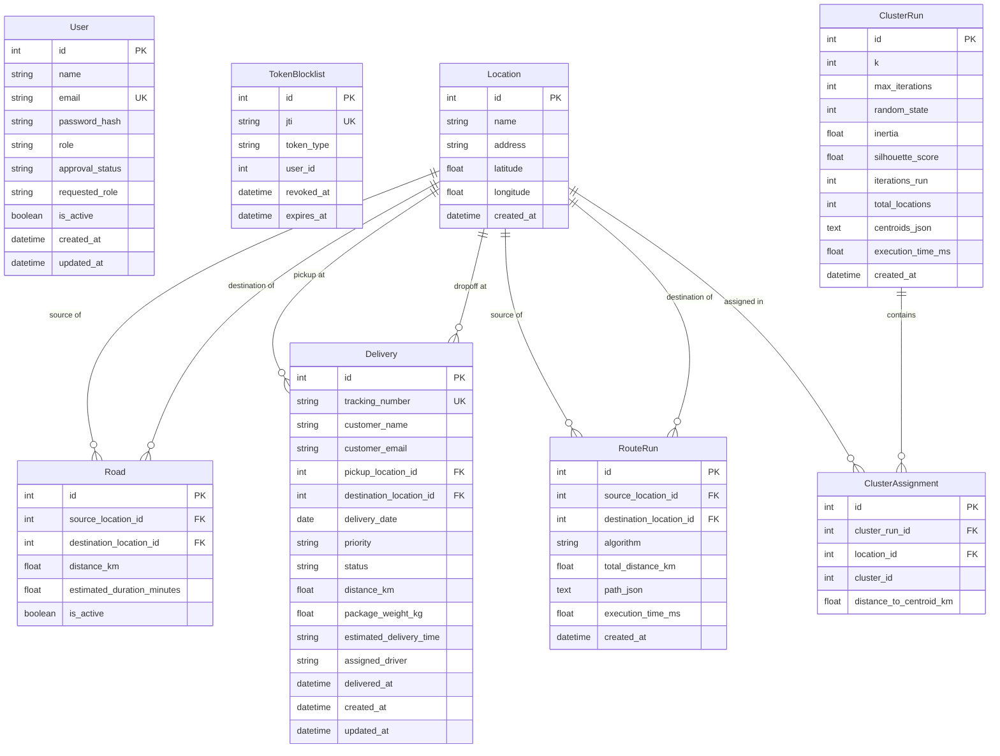

# System Architecture

## Three-Tier Architecture

SmartRoute Pro is organised in a standard three-tier architecture:

1. Presentation Tier (Frontend):
   - Single-page application built with React 19, TypeScript, and Vite.
   - User interfaces styled with Tailwind CSS, data visualizations with Recharts, and interactive maps with Leaflet.
   - Communicates with the backend exclusively over HTTP/JSON using Axios with Bearer token authentication headers.
   - Client-side routing is handled by React Router with role-based route wrappers (`ProtectedRoute`).

2. Application Tier (Backend):
   - REST API built with Python 3.11 and Flask.
   - Implements authentication via JWT (`Flask-JWT-Extended`) and rate-limiting via `Flask-Limiter`.
   - Core computational logic is structured into isolated, testable service modules:
     - Dijkstra shortest path solver and multi-stop TSP delivery run engine.
     - Spatial clustering via K-Means and cartesian coordinate projections.
     - Univariate statistics, OLS bivariate regression, and inferential hypothesis tests.
     - PDF and CSV reporting engines using ReportLab and standard Python libraries.
   - Access control is managed through a central permission decorator enforcing role-based permissions.

3. Persistence Tier (Database):
   - Relational database management using PostgreSQL in containerised environments and SQLite for local development and in-memory testing.
   - Object-relational mapping handled by SQLAlchemy via Flask-SQLAlchemy.
   - Database schema migrations managed through Flask-Migrate and Alembic.

---

## Entity-Relationship Diagram

---

## Role and Permission Matrix

The system maps all API endpoints and application actions to canonical permissions defined in `backend/app/utils/permissions.py`:

| Permission | Description | Allowed Roles |
|---|---|---|
| `dashboard:read` | View top-level KPIs, delivery progress, and fleet metrics | ADMIN, DISPATCHER, VIEWER |
| `profile:self` | View and edit personal profile and change personal password | ADMIN, DISPATCHER, VIEWER |
| `deliveries:read` | Inspect consignment records, delivery lists, and detail modals | DISPATCHER |
| `deliveries:write` | Create, update, delete, and import delivery consignments | DISPATCHER |
| `routes:read` | View graph topology, hubs, roads, and calculated route histories | DISPATCHER |
| `routes:calculate` | Execute Dijkstra shortest path and multi-stop TSP delivery run calculations | DISPATCHER |
| `zones:read` | View territory clustering histories and elbow curve analyses | DISPATCHER |
| `zones:run` | Execute K-Means spatial clustering runs across hubs | DISPATCHER |
| `analytics:read` | Inspect statistical summaries, regressions, and hypothesis tests | ADMIN, DISPATCHER |
| `reports:analytics` | Download statistical analytics PDF reports | ADMIN, DISPATCHER |
| `reports:operational` | Download delivery, route, and territory operational PDF/CSV reports | DISPATCHER |
| `reports:system` | Download full platform summary and cloud infrastructure PDF reports | ADMIN |
| `system:read` | Access real-time system status, host metrics, and infrastructure health | ADMIN |
| `users:manage` | List users, approve or reject registrations, and alter account roles | ADMIN |
| `parcels:own` | Query and track personal consignments by email or tracking code | VIEWER |
| `reports:my_parcels` | Download personal parcel summary PDF and CSV reports | VIEWER |
